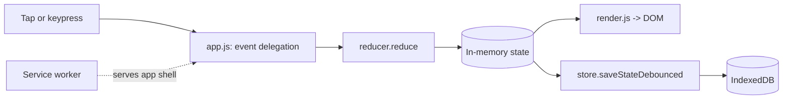

# 02. Architecture

## Decisions

| # | Decision | Reason |
|---|---|---|
| A1 | Plain HTML, CSS, and ES modules. No framework, no bundler. | The app is small. Files can be hosted anywhere and read by anyone. |
| A2 | Unidirectional data flow: event, then action, then reducer, then state, then persist and render. | Keeps logic testable and the UI a pure function of state. |
| A3 | Pure logic modules (`dates.js`, `stats.js`, `reducer.js`) with no DOM access. | Lets unit tests run in Node without a browser. |
| A4 | IndexedDB for storage, with `navigator.storage.persist()` requested. | More durable than localStorage, and structured. |
| A5 | Service worker with a versioned precache and cache-first fetch. | Guarantees offline start and predictable updates. |
| A6 | All URLs relative (`./`). | Works at a domain root and under a subpath such as `user.github.io/habit-log/`. |
| A7 | Fonts self-hosted, with a system font fallback stack. | Offline-safe and no third-party requests. |
| A8 | Strict Content-Security-Policy via meta tag. | Defense in depth for user-entered habit names. |
| A9 | Local-date keys (`YYYY-MM-DD`) in the device time zone, weeks start Monday. | Matches the current page and the owner's expectations. |

## File tree

```
habit-pwa/
  index.html
  manifest.webmanifest
  sw.js
  _headers                     (Cloudflare Pages / Netlify; see 07-deployment.md)
  css/
    tokens.css                 design tokens, light and dark
    app.css                    layout and components
  js/
    app.js                     entry: boot, wiring, event delegation
    dates.js                   pure: local date helpers
    stats.js                   pure: streak, best streak, last-N, history grid data
    reducer.js                 pure: (state, action) -> state
    store.js                   IndexedDB persistence + subscribe + debounce
    render.js                  state -> DOM (string templates, escaped)
    backup.js                  export / import / validation
    pwa.js                     SW registration, update toast, install prompt, iOS hint
  fonts/
    inter-var.woff2
    space-grotesk-var.woff2
  icons/
    icon.svg                   source artwork
    icon-192.png
    icon-512.png
    icon-maskable-512.png
    apple-touch-icon-180.png
    favicon-32.png
  tests/
    dates.test.js
    stats.test.js
    reducer.test.js
    backup.test.js
  docs/                        this pack
  README.md
```

## Module contracts

```js
// dates.js (all take/return local-time Dates; no timezone libs)
export function dateKey(d)            // Date -> 'YYYY-MM-DD'
export function parseKey(k)           // 'YYYY-MM-DD' -> Date at local midnight
export function addDays(d, n)         // calendar days, DST safe (use new Date(y, m, d + n))
export function startOfToday(now = new Date())
export function mondayOf(d)           // Monday of d's week
export function dayNumber(k)          // integer day index via Date.UTC, for consecutive-day checks

// stats.js
export function isDone(state, habitId, key)
export function currentStreak(state, habitId, today)        // see spec FR-3
export function bestStreak(state, habitId)                   // see spec FR-4
export function doneInLast(state, habitId, days, today)      // see spec FR-5
export function weekCells(state, habitId, today)             // 7 items {key, date, done, future, isToday}
export function historyGrid(state, habitId, today, weeks=12) // {cells:[{done|future}], done, total}

// reducer.js
// Actions: TOGGLE_DAY{habitId,key} ADD_HABIT{id,name} RENAME_HABIT{id,name}
//          DELETE_HABIT{id} IMPORT_STATE{state, mode:'replace'|'merge'}
export function reduce(state, action, now = Date.now())     // returns NEW state, sets updatedAt

// store.js
export async function loadState()                  // -> normalized state (defaults if none)
export function saveStateDebounced(state)          // ~400 ms debounce, serialized writes
export async function requestPersistence()         // navigator.storage.persist() once
export function subscribe(fn)                      // notified after save success/failure

// backup.js
export function exportBackup(state)                // -> {app, schema, exportedAt, state}
export function parseBackup(text)                  // -> {ok, state} | {ok:false, error}
export async function shareOrDownload(json)        // Web Share with file, else anchor download, else copy
```

## Data flow



1. `app.js` boots: load state from IndexedDB (or defaults), render, register the service worker.
2. Every user action dispatches an action to the reducer, which returns a new state object (never mutate).
3. After each action the app renders from state, then schedules a persisted write.
4. Rendering rebuilds the habit cards and history with escaped string templates, then restores keyboard focus to the same day button if one was just used.

## Rendering rules

- Never insert user text with `innerHTML` unescaped. Use an `esc()` helper for every dynamic string, or set `textContent`.
- Do not write inline `style="..."` attributes in templates (blocked by CSP). Progress bar width is set through `element.style.width` in JavaScript, which the CSP allows.
- No inline `<script>` or inline event handlers. One `<script type="module" src="./js/app.js">`.

## Content-Security-Policy

```html
<meta http-equiv="Content-Security-Policy"
  content="default-src 'self'; script-src 'self'; style-src 'self'; img-src 'self' data:; font-src 'self'; connect-src 'self'; manifest-src 'self'; base-uri 'self'; form-action 'self'">
```

Adjust only if a milestone truly needs it, and note the reason in the README.

## Time handling

- "Today" is the device's local calendar date, recomputed on `visibilitychange` and by a 30 second interval. When the date key changes, re-render.
- Use `new Date(y, m, d + n)` for day arithmetic so daylight saving changes never skip or repeat a day.
- Use `Date.UTC(y, m, d) / 86400000` rounded for comparing consecutive days.
- Stored keys never change if the device time zone changes. A check-in belongs to the calendar date the owner saw when tapping.

## Error handling

- IndexedDB unavailable (private mode, blocked): fall back to in-memory state, show a visible banner "Storage is unavailable. Changes will be lost when you close the app." and keep the app usable.
- Write failure: keep state in memory, show "Could not save. Retrying." and retry once after 1.5 to 2.5 seconds, then show a persistent "Not saved" status with a button to download a backup.
- Corrupt stored data: normalize on load (see `05-data-storage-sync.md`), never crash. Keep a copy of the raw value under `app/corrupt-backup` before overwriting.

## Performance budget

- First load transfer: under 150 KB excluding fonts. Fonts: under 120 KB total (subset to Latin).
- No layout shift on load. First render happens before the IndexedDB read finishes only if showing a skeleton is cheaper than waiting. The preferred approach is to wait for the read (typically a few milliseconds) and render once.
- Interactions (tap to visual update) under 100 ms.

## Browser support

iOS and iPadOS Safari 16.4 or newer (installed web apps), macOS Safari 17 or newer (Add to Dock), current Chrome, Edge and Firefox for desktop and Android. The app must still run as an ordinary web page in any modern browser even if the service worker is unavailable.
